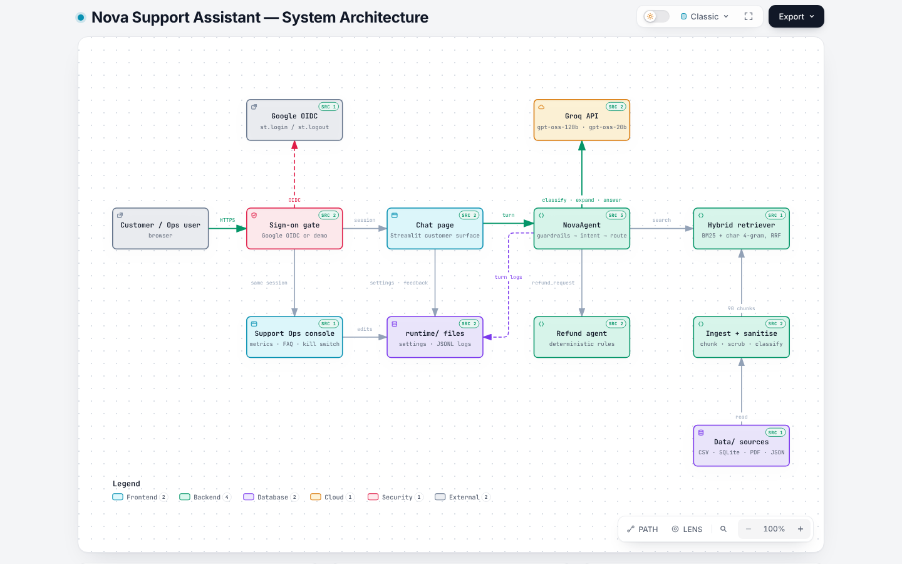
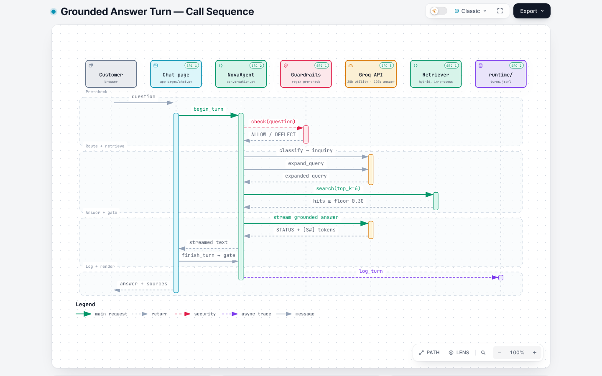
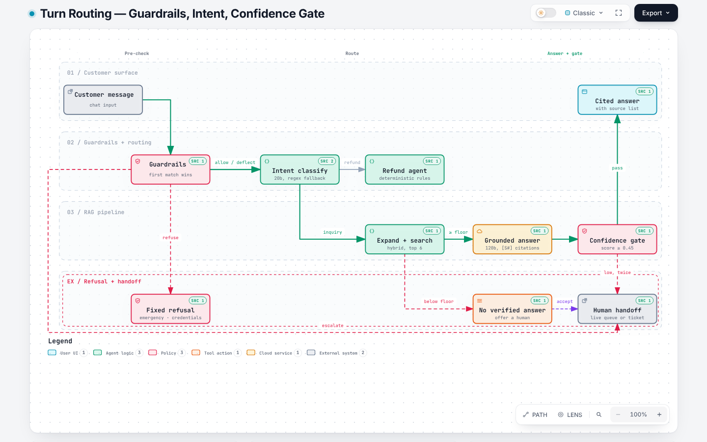
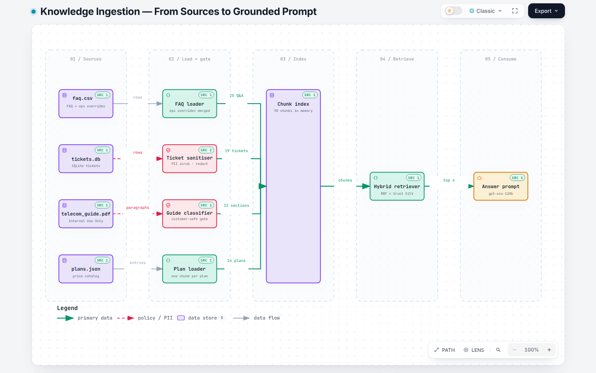
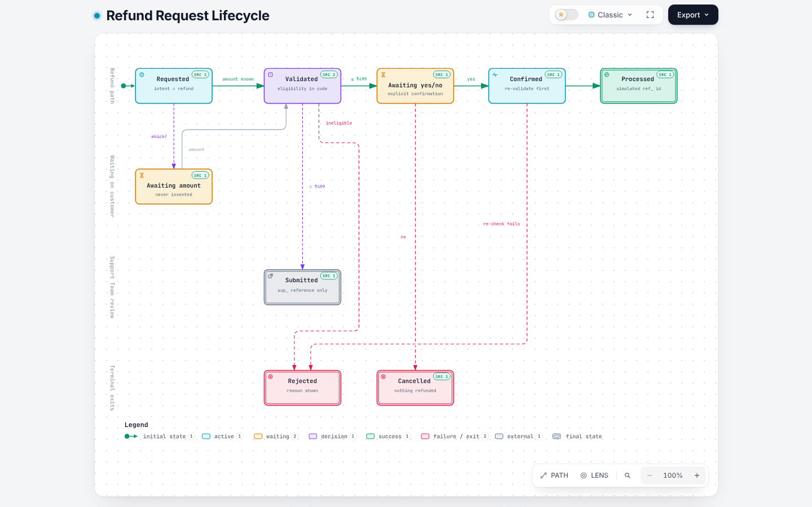

# Nova Support Assistant — System Design

| | |
|---|---|
| **Status** | Draft — describes the reference implementation as built |
| **Authors** | Generated with the `system-design-doc` skill from repository evidence |
| **Last updated** | 2026-11-17 |
| **Repository** | https://github.com/pankajmehta1827/NovaRagAgent @ `218666e53b81aa896b03b382685f2f76b71f8fc3` |
| **Related** | [PRD.md](../../../PRD.md) · [agent_PRD.md](../../../agent_PRD.md) · [README.md](../../../README.md) |

## 1. Overview

Nova is NovaCell's Tier‑1 customer-support assistant: a Streamlit app that answers
plain-language questions **only** from four verified knowledge sources (a plans catalog,
an FAQ, resolved support tickets, and a technical guide PDF), cites every fact, refuses
when it cannot ground an answer, and hands off to a human with the full transcript. A
second route handles refund requests with a deterministic, simulated refund agent.

The central design idea is that **the model decides as little as possible**. Regex
guardrails run before anything is retrieved. A lexical hybrid retriever decides what
evidence exists, and if nothing clears the relevance floor the answer model is never
called. A scored confidence gate decides whether a generated answer is trusted. In the
refund route the LLM only classifies the intent; eligibility, the ₹499 approval limit
and confirmation parsing are application code (`nova/refund.py:1-17`).

The repository is a **reference implementation**. Persistence is flat files, there is
no live agent desktop, and the refund ledger is hard-coded demo data. Section 13 lists
the gaps against the PRD.

## 2. Goals and non-goals

**Goals** (PRD §1.2, §5):
- Answer Tier‑1 questions grounded exclusively in NovaCell's verified knowledge (groundedness ≥ 99%, NFR‑1.1).
- Never invent prices, fees, timings or policy (NFR‑1.2), and say "I don't know" instead.
- Escalate cleanly, with transcript, cited sources and a reason code (FR‑4.3).
- Let Support Ops change knowledge and thresholds without a release (FR‑5.x).
- Process simple refunds within strict, deterministic rules (agent PRD §6).

**Non-goals** (PRD §1.4): replacing the contact centre, sales/upsell, account servicing
on live systems, or general-purpose chat. The refund agent touches no real billing,
payment or CRM system (`nova/refund.py:12`).

## 3. Requirements

### 3.1 Functional

| ID | Requirement (abridged) | Where it is met |
|---|---|---|
| FR‑1.2 | Stream the answer token by token | `nova/llm.py:230-331`, `app_pages/chat.py:378-379` |
| FR‑2.2 / 2.4 | Hybrid retrieval, top‑k with per-source cap | `nova/retriever.py:148-193` |
| FR‑2.5 | Every fact cited with a source marker | `nova/llm.py:103-130`, citation parse `nova/llm.py:328` |
| FR‑2.7 | Source trust order plans > FAQ > guide > ticket | `nova/config.py` (`SOURCE_TRUST`), trust tilt `nova/retriever.py:168-170` |
| FR‑2.9 | Resolved tickets only | `nova/ingest.py:152-154` |
| FR‑3.1 / 3.2 | Confidence gate and relevance floor | `nova/conversation.py:98-107`, `:159-224` |
| FR‑3.3 | Withhold internal-only guide content | `nova/ingest.py:274-290` |
| FR‑3.6 / 4.1 | Refuse/escalate categories before retrieval | `nova/guardrails.py:130-162` |
| FR‑4.3 / 4.4 | Handoff payload, staffed-hours routing | `nova/escalation.py:18-67` |
| FR‑4.7 | Global kill switch | `app_pages/chat.py:15-26`, `app_pages/ops_console.py` |
| FR‑5.1 / 5.5 / 5.6 | FAQ overrides, rollback, unanswered queue | `nova/store.py:72-91`, `:127-166` |
| FR‑6.2 / 6.3 | Turn logging and dashboard metrics | `nova/conversation.py:254-274`, `nova/store.py:169-221` |
| Agent FR‑01 | Two-intent routing | `nova/intent.py:71-104` |
| Agent FR‑36 / GR‑01 | Explicit confirmation before executing a refund | `nova/refund.py:401-447` |

### 3.2 Non-functional

| Attribute | Target (PRD) | How the design addresses it |
|---|---|---|
| Groundedness | ≥ 99% (NFR‑1.1) | Sources-only system prompt; citation coverage weighs 0.35 in the confidence score |
| Fabricated figures | zero (NFR‑1.2) | Verbatim-facts rule in the answer prompt; plans catalog has top trust |
| Latency | TTFT P50 ≤ 1.5s, P95 ≤ 3.0s (NFR‑2.1) | Streaming; low reasoning effort on the 120b model; cheap 20b model for pre-stages; in-process retrieval. **Not measured in this repo.** |
| Degradation | Never a blank error (NFR‑2.5) | Utility-stage failures fall back; answer-stage failure becomes an escalation offer |
| Privacy | PII scrubbed at index time (NFR‑3.2) | `nova/sanitise.py` scrubs tickets; credential disclosures get a fixed refusal |
| Cost | ≤ $0.25 per contained conversation (NFR‑4.1) | 20b model for non-generative stages; cost estimate per turn in the ops console (`nova/store.py:192-197`) |
| Access control | RBAC on the ops console (NFR‑3.7) | **Not met** — see §9 |

## 4. System context

- **Customers and Support Ops staff** use the same Streamlit app through a browser. Both
  pass one sign-on gate (`streamlit_app.py:32-48`).
- **Google OIDC** (optional) authenticates users through Streamlit's native `st.login`;
  without complete secrets the app offers a labelled demo entry (`nova/auth.py:46-111`).
- **Groq API** is the only outbound model dependency. It serves `openai/gpt-oss-120b`
  for answers and `openai/gpt-oss-20b` for intent classification and query expansion
  (`nova/config.py:35-38`). The key comes from `GROQ_API_KEY` (`nova/llm.py:35-42`).
- **Local files**: knowledge sources under `Data/`, and runtime state under `runtime/`
  (settings, FAQ overrides, JSONL logs; `nova/config.py:15-26`). `runtime/` is
  git-ignored.

Figure 1 shows these dependencies together with the internal components, so a separate
context diagram would only repeat it.

## 5. Architecture

### 5.1 Component overview

**Figure 1 — System architecture.** What are the major components, and how does a customer turn move through them?

Interactive version: [`diagrams/01-architecture/architecture.html`](diagrams/01-architecture/architecture.html)
· Archify `architecture` · gates: validate ✔ deliver ✔ check ✔ browser-check ✔

### 5.2 Component responsibilities

| Component | Responsibility | Key modules | State it owns |
|---|---|---|---|
| Console shell | Page config, session init, navigation, sign-out | `streamlit_app.py:13-76` | `st.session_state` (messages, history, handoff) |
| Sign-on gate | Google OIDC or demo entry; gates, does not authorise | `nova/auth.py`, `app_pages/signon.py` | `demo_user` flag |
| Chat page | Customer surface; drives a turn; renders sources, handoff, refund confirm buttons | `app_pages/chat.py` | per-session `RefundFlow`, consecutive-ungrounded counter |
| NovaAgent | Turn orchestration: guardrails → intent → retrieval → answer → gate → escalation → log | `nova/conversation.py:51-274` | in-memory index and retriever (cached per settings signature) |
| Guardrails | Pre-retrieval REFUSE / ESCALATE / DEFLECT / ALLOW | `nova/guardrails.py` | none (pure) |
| Intent classifier | `requirement_inquiry` vs `refund_request`, regex fallback | `nova/intent.py` | none |
| LLM adapter | Query expansion; streamed grounded answer with STATUS line and `[S#]` citations | `nova/llm.py` | none |
| Hybrid retriever | BM25 + char 4-gram cosine, RRF fusion, trust tilt, per-source cap | `nova/retriever.py` | term and n-gram statistics |
| Ingest + sanitise | Load four sources, chunk, PII scrub, internal-action redaction, guide gate, audit report | `nova/ingest.py`, `nova/sanitise.py` | `IngestReport` |
| Refund agent | Simulated ledger, deterministic validation, confirmation state machine | `nova/refund.py` | session ledger copy, workflow state |
| Escalation | Handoff payload, staffed-hours routing, customer message | `nova/escalation.py` | none |
| Store | Settings, FAQ overrides, turn/feedback/escalation JSONL, metrics, unanswered queue | `nova/store.py` | `runtime/*.json(l)` |
| Support Ops console | Metrics, gaps queue, FAQ editing, guide gate overrides, kill switch, republish | `app_pages/ops_console.py` | writes settings and overrides |

### 5.3 Key design decisions

**D1 — Lexical hybrid retrieval instead of embeddings.**
*Context:* a 90-chunk corpus, with queries that mix symptom language and exact tokens (`APN`, `*123#`).
*Decision:* BM25 plus character 4-gram cosine, fused with RRF, in pure Python (`nova/retriever.py:1-15`); a 20b query rewrite bridges the semantic gap.
*Alternatives:* an embedding index (FR‑2.2's assumption), or a hosted vector DB.
*Consequences:* no index service and no embedding cost, but it will not scale to an FAQ-sized corpus. The README lists it as a known gap.

**D2 — Absolute relevance for the gate, rank fusion for ordering.**
RRF scores say which chunk is best, not whether it is any good, so the gate uses a saturating BM25 + n‑gram relevance instead (`nova/retriever.py:56-65`). Below the 0.30 floor the turn refuses **without** calling the answer model, which is both correct and cheap (`nova/conversation.py:98-107`).

**D3 — Guardrails before intent and retrieval.**
Emergencies, credential disclosures, requests for a human, fraud, disputes, cancellation, complaints, outages and vulnerability signals are pattern-matched first, and the first match wins (`nova/guardrails.py:130-162`). A human request or a card number therefore outranks a refund in progress (`nova/conversation.py:76-82`).

**D4 — The refund agent is a state machine, not a tool-using LLM.**
`process_refund` and `submit_to_support` are never exposed to the model (`nova/refund.py:90-93`). Eligibility, recharge matching, the approval limit and yes/no parsing are code, and the refund is re-validated immediately before it executes (`nova/refund.py:424-431`).

**D5 — Confidence is a weighted blend, not a model self-report.**
`0.45 × retrieval + 0.2 × source agreement + 0.35 × citation presence`, with ticket-only evidence discounted by 20% (`nova/conversation.py:200-224`). An answer that cites nothing cannot pass a 0.45 threshold unless retrieval and agreement are both near-perfect.

**D6 — Files, not services, for runtime state.**
Settings, overrides and logs are JSON and JSONL under `runtime/` (`nova/store.py:1-6`), so the app runs with no infrastructure. The production counterparts are a config service, a knowledge CMS and an analytics warehouse.

## 6. Runtime behaviour

### 6.1 Grounded answer turn

**Figure 2 — Call sequence.** What calls happen, and in what order, when a customer asks a support question?

Interactive version: [`diagrams/02-turn-sequence/turn-sequence.html`](diagrams/02-turn-sequence/turn-sequence.html)
· Archify `sequence` · gates: validate ✔ deliver ✔ check ✔ browser-check ✔

1. The chat page calls `begin_turn(question, history, flow)` (`app_pages/chat.py:365`).
2. Guardrails classify the message. REFUSE returns fixed text; ESCALATE marks the turn for handoff (`nova/conversation.py:62-74`).
3. Unless a refund is pending, the 20b model classifies the intent. A classifier error falls back to a regex (`nova/intent.py:71-104`).
4. For an inquiry, the 20b model expands the query from the last four turns. If it fails, the original question is used (`nova/llm.py:69-100`).
5. The retriever returns up to 6 hits (max 3 per source). If the best absolute relevance is below 0.30, the turn ends as `NO_VERIFIED_ANSWER` with an offer of a human (`nova/conversation.py:91-107`).
6. The chat page streams `agent.stream()`. The 120b model receives the hits as numbered, untrusted sources and emits a hidden `STATUS:` line followed by `[S#]`-cited text (`nova/llm.py:230-331`).
7. `finish_turn` computes confidence and decides on an escalation offer. A second consecutive ungrounded turn escalates automatically (`nova/conversation.py:159-198`).
8. `log` appends the turn (status, confidence, chunk ids, citations, intent, latency, token usage) to `runtime/turns.jsonl` (`nova/conversation.py:254-274`).

### 6.2 Turn routing and exits

**Figure 3 — Turn routing.** Which gates and branches decide whether a turn ends as an answer, a refusal, a refund or a handoff?

Interactive version: [`diagrams/03-turn-routing/turn-routing.html`](diagrams/03-turn-routing/turn-routing.html)
· Archify `workflow` · gates: validate ✔ deliver ✔ check ✔ browser-check ✔

| Outcome | Trigger | Customer sees |
|---|---|---|
| REFUSED | Emergency phrasing, or credentials in the message | Fixed text; credentials are not echoed or used |
| ESCALATED | Human request, hard-route category, blocklist hit, frustration after ≥ 2 turns | Handoff message: live queue during staffed hours (08–22), otherwise a ticket reference |
| DEFLECT + answer | Account-specific question ("my bill") | A grounded general answer plus a deep link to the MyTelecom app |
| REFUND | Intent `refund_request`, or a refund already pending | Fixed refund-agent text, with confirm/cancel buttons when relevant |
| NO_VERIFIED_ANSWER | Relevance below the floor, or model STATUS | "I don't have a verified answer…" and an offer of a human |
| ERROR | Answer call raised | Apology and an offer of a human, never a guessed answer |
| ANSWERED | Passed the gate | Cited answer and a source list; thumbs-down also offers a human |

## 7. Data design

### 7.1 Knowledge data flow

**Figure 4 — Knowledge ingestion.** How does content get from the source files into the answer prompt, and what is filtered out on the way?

Interactive version: [`diagrams/04-knowledge-dataflow/knowledge-dataflow.html`](diagrams/04-knowledge-dataflow/knowledge-dataflow.html)
· Archify `dataflow` · gates: validate ✔ deliver ✔ check ✔ browser-check ✔

Measured on this revision (`build_index` with default settings):

| Source | File | Chunks indexed | Withheld / excluded | Trust |
|---|---|---|---|---|
| Plans catalog | `Data/plans.json` | 14 (one per plan, never split) | — | 4 |
| FAQ | `Data/faq.csv` + `runtime/faq_overrides.json` | 25 | — | 3 |
| Technical guide | `Data/telecom_guide.pdf` | 32 | 17 sections classified internal | 2 |
| Resolved tickets | `Data/tickets.db` (SQLite) | 19 (14 marked agent-only) | TK-020 (status `escalated`) | 1 |
| **Total** | | **90** | | |

### 7.2 Data model and storage

- **`Chunk`** (`nova/ingest.py:24-55`): `id`, `source`, `title`, `text`, `category`, `trust`, `meta`. The `citation` property names the document, not just its category.
- **`IngestReport`** (`nova/ingest.py:56-66`): counts, withheld guide sections with reasons, agent-only tickets, excluded tickets. It is shown in the ops console.
- **Runtime files** (`nova/config.py:15-26`): `settings.json` (ops-editable keys only, merged over `DEFAULT_SETTINGS`), `faq_overrides.json`, `turns.jsonl`, `feedback.jsonl`, `escalations.jsonl`.
- **Handoff payload** (`nova/escalation.py:25-49`): `handoff_id`, `reason_code`, `routing` (`live_agent_queue` or `ticket`), `ticket_ref`, `cited_sources`, and the full transcript.
- **Caching:** the agent and its index are built once per *settings signature* (a hash of settings and overrides) with `st.cache_resource`. Republishing clears the cache, and a stale class from before a code reload is detected and rebuilt (`nova/ui.py:40-112`).

No retention or deletion is implemented for `runtime/` logs (NFR‑3.3 asks for 90 days).

### 7.3 Refund lifecycle

**Figure 5 — Refund lifecycle.** Which states can a refund request be in, and what moves it between them?

Interactive version: [`diagrams/05-refund-lifecycle/refund-lifecycle.html`](diagrams/05-refund-lifecycle/refund-lifecycle.html)
· Archify `lifecycle` · gates: validate ✔ deliver ✔ check ✔ browser-check ✔

Eligibility rules (`nova/refund.py:104-187`): the recharge is `completed`, not already
refunded, at most 7 days old, and the amount does not exceed it. An exact amount match
identifies the recharge even if it was already refunded, so the customer gets the true
reason. The ledger is deep-copied per session, and "Clear conversation" reseeds it
(`app_pages/chat.py:43-45`, `:166-173`).

## 8. Interfaces

- **UI surfaces** (Streamlit multipage, `streamlit_app.py:36-48`): *Sign on* (only page while signed out), *Chat*, *Support Ops*.
- **Internal API** — `NovaAgent.begin_turn / stream / finish_turn / escalate / log` (`nova/conversation.py`). The chat page is the only caller.
- **Groq Chat Completions**: `temperature 0.0` for utility calls and `0.2` for answers; `reasoning_format="hidden"`; streamed answers; token usage captured per call.
- **Configuration**: `GROQ_API_KEY` (env or `.streamlit/secrets.toml`); `[auth]` / `[auth.google]` secrets for OIDC (`.streamlit/secrets.toml.example`).
- **Outbound handoff**: produced by `escalation.build_handoff`, but nothing consumes it yet.

## 9. Security and privacy

- **Authentication:** Google OIDC via Streamlit when fully configured. Placeholder secrets are detected and the demo path is used instead (`nova/auth.py:30-68`).
- **Authorisation:** none. Anyone past the gate, including a demo user, reaches the Support Ops console, which can edit knowledge and take the assistant offline. The README states this explicitly. NFR‑3.7 (RBAC, audit log) is **not met**.
- **PII:** ticket text is scrubbed at index time (emails, phone and long numbers, identifiers, titled names, addresses, IPs), while short codes and `611` are preserved (`nova/sanitise.py:16-57`). Customer messages with credentials get a fixed refusal. Customer messages are **not** redacted before they are logged to `turns.jsonl` (NFR‑3.1 asks for redaction at ingress).
- **Content safety:** internal-only guide content is withheld by a classifier with ops overrides; internal remediation detail is stripped from ticket resolutions (FR‑3.4).
- **Prompt injection:** retrieved chunks are passed as data in the user turn, under a sources-only system prompt (`nova/llm.py:185-215`). There is no adversarial test set (R‑7, NFR‑1.3).
- **Secrets:** `.env` and `.streamlit/secrets.toml` are git-ignored.

## 10. Reliability and operations

| Failure | Detection | Impact | Mitigation in code |
|---|---|---|---|
| Groq unavailable for utility calls | exception | weaker routing or retrieval | intent regex fallback; unexpanded query |
| Groq unavailable for answers | exception → `ERROR` status | no answer | fixed apology and offer of a human (`nova/conversation.py:178-184`) |
| Missing API key | `get_agent` | chat unusable | clear on-page error (`nova/ui.py:71-80`) |
| Bad answers in production | thumbs-down, low confidence | customer harm | unanswered queue; kill switch (FR‑4.7) |
| Code reloaded under a cached agent | signature check | `TypeError` | stale agent detected and rebuilt (`nova/ui.py:51-68`) |
| Corrupt runtime JSON | parse error | lost settings or log lines | read falls back to defaults; bad JSONL lines skipped (`nova/store.py:22-55`) |

**Deployment:** a single Streamlit process (`streamlit run streamlit_app.py --server.port 8502`), with a dev container in `.devcontainer/`. There is no deployment topology beyond one process, so no deployment diagram is included.

## 11. Scalability and performance

- Retrieval scores every chunk on every query, which is O(corpus) in pure Python. That is fine for 90 chunks and not for an FAQ-scale corpus.
- The index and agent live in process memory (one per settings signature); `runtime/` files are appended without locking. One process is the supported topology; multiple replicas would each hold their own index and race on log files.
- Per-turn cost is dominated by the 120b answer call. The PRD measured about $0.0003 per grounded turn (NFR‑4.2); the ops console estimates cost from logged token usage.
- At 10× corpus or traffic: move to an embedding index, a re-ranker, a shared store for logs and settings, and a stateless app tier.

## 12. Testing and quality

- **`selfcheck.py`** — an offline regression suite (no API key) covering ingestion, the resolved-only filter, the guide gate, ticket sanitisation, retrieval, the plans catalog, the relevance floor, guardrails, PII scrubbing, intent fallback, refund scenarios, confirmation guardrails and ledger isolation. **106 checks, all passing at this revision.**
- **`smoketest.py`** — end-to-end scenarios against the live Groq API (needs `GROQ_API_KEY`); prints status, confidence, citations and cost per turn. Not run for this document.
- **Not built:** the weekly human review sample (FR‑6.4), the adversarial refusal set (NFR‑1.3), and latency and load tests (NFR‑2.x).

## 13. Risks, open questions, and future work

**Risks**

| Risk | Likelihood | Impact | Mitigation |
|---|---|---|---|
| Ops console reachable by any signed-in or demo user | High | High — knowledge edits, kill switch | Separate customer and ops sign-in; RBAC and audit log (NFR‑3.7) |
| Thin corpus → high refusal rate (PRD R‑4) | High | Medium | Unanswered queue drives authoring; keep the refusal bar high |
| Lexical retrieval misses paraphrases | Medium | Medium | 20b query expansion now; embedding index later |
| Unredacted customer text in `turns.jsonl` | Medium | High — privacy | Scrub at ingress before logging; 90-day retention job |
| Prompt injection through ticket or guide text | Low | Medium | Data-not-instruction prompt; build the adversarial suite |

**Open questions** (from research)

- Latency against NFR‑2.1/2.2 is unmeasured; `latency_ms` is logged per turn, but there are no recorded runs to report.
- Is `runtime/` intended to persist across deployments? Streamlit Cloud filesystems are ephemeral, which would reset settings and logs.
- PRD Q‑1 (staffed hours) is answered in code with an ops-editable default of 08:00–22:00; it is unconfirmed by Support Ops.
- Currency: refunds use ₹ (agent PRD) while the knowledge base quotes USD. Is this intentional for production?

**Future work** — follows the README's known gaps and PRD §8: an embedding index and re-ranker, a knowledge CMS and analytics warehouse, consuming the handoff payload in a real agent desktop, read-only account integration (v2), and the evaluation sets.

## Appendix A — Diagram index

| # | Diagram | Type | Question | HTML | Archify gates |
|---|---|---|---|---|---|
| 1 | System architecture | architecture | Components and the main journey | [architecture.html](diagrams/01-architecture/architecture.html) | validate ✔ deliver ✔ check ✔ browser ✔ |
| 2 | Grounded answer turn | sequence | Call order for one question | [turn-sequence.html](diagrams/02-turn-sequence/turn-sequence.html) | validate ✔ deliver ✔ check ✔ browser ✔ |
| 3 | Turn routing | workflow | Gates and exits for a turn | [turn-routing.html](diagrams/03-turn-routing/turn-routing.html) | validate ✔ deliver ✔ check ✔ browser ✔ |
| 4 | Knowledge ingestion | dataflow | Sources to prompt, with filters | [knowledge-dataflow.html](diagrams/04-knowledge-dataflow/knowledge-dataflow.html) | validate ✔ deliver ✔ check ✔ browser ✔ |
| 5 | Refund lifecycle | lifecycle | States of a refund request | [refund-lifecycle.html](diagrams/05-refund-lifecycle/refund-lifecycle.html) | validate ✔ deliver ✔ check ✔ browser ✔ |

Every diagram cites source line ranges at revision `218666e`; open the HTML and click a node's **SRC** badge to see them. Diagrams were produced with Archify v3.0.1 (tt-a1i/archify, MIT).

## Appendix B — Glossary

- **Chunk** — one retrievable unit of verified knowledge.
- **Relevance floor** — minimum absolute relevance (0.30) for any answer to be attempted.
- **Confidence gate** — weighted score (threshold 0.45) that decides whether an answer is trusted.
- **Deflection** — answering the general question while pointing to the app for account data.
- **Handoff** — the escalation payload with transcript, sources and reason code.
- **RRF** — Reciprocal Rank Fusion, which combines BM25 and n-gram rankings.
